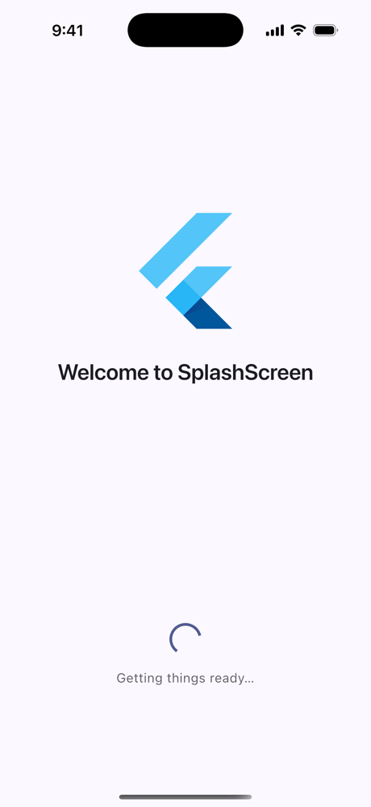
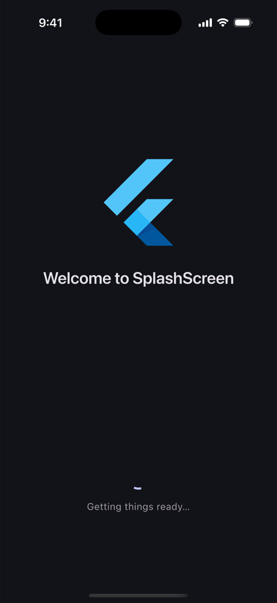
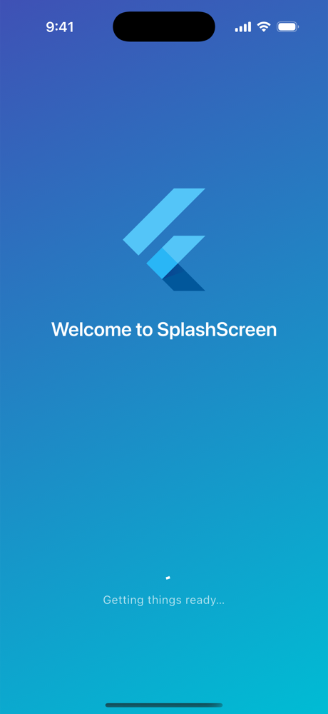

# [Splash Screen](https://pub.dev/packages/splashscreen)

A customizable, theme-aware splash screen for Flutter. Show it for a fixed time or until your app finishes loading, then hand off to the next page with a smooth transition.

* Material 3 / dark mode aware: colors come from your `Theme` by default
* Timer **or** future based navigation, with `minDuration` and `onError`
* Type-safe destinations: page, named route, custom route, or your own router (go_router, auto_route…)
* Entrance animations (`fade`, `scale`, `fadeScale`, `slideUp`) that respect reduced-motion settings
* Any widget for logo, title, message and loader
* Gradient / image backgrounds, automatic status bar contrast, `Hero` logo hand-off

## Currently Supported by awesome [DPLYR](https://dplyr.dev)


* [DPLYR](https://dplyr.dev) is a new generation of cloud platforms and aims to help developers in their road with open source contributions, and at the end we can say thanks.

## Screenshots

| Light | Dark | Gradient |
| --- | --- | --- |
|  |  |  |

## Install

```sh
flutter pub add splashscreen
```

## Usage

### Time based

```dart
import 'package:flutter/material.dart';
import 'package:splashscreen/splashscreen.dart';

void main() => runApp(
      MaterialApp(
        theme: ThemeData(colorSchemeSeed: Colors.indigo),
        home: const SplashScreen.timer(
          duration: Duration(seconds: 3),
          destination: SplashDestination.page(HomePage()),
          logo: FlutterLogo(),
          title: Text('Welcome'),
          message: Text('Loading…'),
        ),
      ),
    );
```

### Future based

Resolve the future to wherever the app should go. `minDuration` avoids a flash when loading is instant; `onError` picks a fallback.

```dart
Future<SplashDestination> bootstrap() async {
  final user = await auth.restoreSession();
  return user == null
      ? const SplashDestination.named('/login')
      : const SplashDestination.page(HomePage());
}

SplashScreen.future(
  future: bootstrap(),
  minDuration: const Duration(seconds: 1),
  onError: (error, stackTrace) => const SplashDestination.named('/offline'),
  logo: Image.asset('assets/logo.png'),
  title: const Text('My App'),
);
```

> Create the future once (e.g. in `initState` or a provider) if the widget that builds the splash can rebuild. The splash only listens to the future it was first given.

### Destinations

```dart
SplashDestination.page(const HomePage())                  // fade transition
SplashDestination.page(const HomePage(), name: '/home')   // with RouteSettings
SplashDestination.named('/home', arguments: user)          // named route
SplashDestination.route(MyCustomRoute())                   // custom transition
SplashDestination.custom((context) => context.go('/home')) // go_router & co.
```

### Styling

```dart
SplashScreen.timer(
  duration: const Duration(seconds: 3),
  destination: const SplashDestination.page(HomePage()),
  logo: const FlutterLogo(),
  logoSize: 160,
  title: const Text('Welcome'),
  backgroundGradient: const LinearGradient(
    begin: Alignment.topLeft,
    end: Alignment.bottomRight,
    colors: [Color(0xFF3F51B5), Color(0xFF00BCD4)],
  ),
  foregroundColor: Colors.white,
  loaderColor: Colors.white,
  animation: SplashAnimation.slideUp,
  animationDuration: const Duration(milliseconds: 900),
  transitionDuration: const Duration(milliseconds: 600),
);
```

| Option | Default | Description |
| --- | --- | --- |
| `logo` | — | Any widget (`Image`, `FlutterLogo`, `Icon`, Lottie…) |
| `logoSize` | `120` | Size of the logo box |
| `heroTag` | `SplashScreen.defaultHeroTag` | `Hero` tag on the logo, `null` to disable |
| `title` / `message` | — | Widgets above / below the loader, themed text styles |
| `showLoader` / `loader` / `loaderColor` | `true` / spinner / `primary` | Loading indicator |
| `backgroundColor` | `colorScheme.surface` | Background color |
| `foregroundColor` | `onSurface` or auto contrast | Title / message color |
| `backgroundGradient` / `backgroundImage` | — | Painted over the background color |
| `animation` | `SplashAnimation.fadeScale` | Entrance animation |
| `animationDuration` / `animationCurve` | `700ms` / `easeOutCubic` | Entrance timing |
| `transitionDuration` | `400ms` | Fade into a `SplashDestination.page` |
| `systemOverlayStyle` | auto | Status / navigation bar style |
| `onTap` | — | Tap anywhere callback |

### Hero logo hand-off

The logo is wrapped in a `Hero` tagged `SplashScreen.defaultHeroTag`. Use the same tag on the destination page and the logo flies across:

```dart
const Hero(tag: SplashScreen.defaultHeroTag, child: FlutterLogo(size: 64))
```

## Migrating from 2.x

| 2.x | 3.x |
| --- | --- |
| `SplashScreen.timer(seconds: 3, ...)` | `SplashScreen.timer(duration: Duration(seconds: 3), ...)` |
| `navigateAfterSeconds: HomePage()` | `destination: SplashDestination.page(HomePage())` |
| `navigateAfterSeconds: '/home'` | `destination: SplashDestination.named('/home')` |
| `navigateAfterFuture: Future<Widget/String>` | `future: Future<SplashDestination>` |
| `pageRoute: route` | `destination: SplashDestination.route(route)` |
| `routeName: '/home'` | `SplashDestination.page(page, name: '/home')` |
| `image: Image(...)` / `photoSize` (radius) | `logo: ...` / `logoSize` (width & height) |
| `title: Text(...)` | `title: ...` (any widget) |
| `loadingText` / `loadingTextPadding` | `message` (wrap in `Padding` if needed) |
| `styleTextUnderTheLoader` | style the `message` widget or set `foregroundColor` |
| `useLoader` | `showLoader` |
| `imageBackground: provider` | `backgroundImage: DecorationImage(image: provider, fit: BoxFit.cover)` |
| `gradientBackground` | `backgroundGradient` |
| `onClick` | `onTap` |
| `backgroundColor` defaulted to white | defaults to `colorScheme.surface` |

### All Supported Projects by [DPLYR](https://dplyr.dev)

* [Splash Screen - Flutter](https://github.com/DPLYR-dev/SplashScreenFlutterPackage)
  <br> a flutter package created to show simple splashscreen

* [In App Call Alert - Flutter](https://github.com/DPLYR-dev/InAppCallAlert)
  <br> a flutter package created to show call alert with sound

* [File Manager](https://github.com/DPLYR-dev/file-manager)
  <br> a php project created to manage machines/servers through ftp servers
  
* [Countries Js](https://github.com/DPLYR-dev/file-manager)
  <br> a javascript project created for retrieving country details with flexibility.
  
* [Block temp mails](https://github.com/DPLYR-dev/block-temp-emails)
  <br> a javascript api to prevent temporary emails from signing up on your website. Super easy to use
  
* [Disposable Emails List](https://github.com/DPLYR-dev/disposable-emails-list-domains-spam)
  <br> a python script to generate the temporary and spam doamins to prevent them and you can block them through this API [Block temp mails](https://github.com/DPLYR-dev/block-temp-emails)

* [Basic CRM](https://github.com/DPLYR-dev/basic-crm)
  <br> A crm that is developed with Node Js for entreprenurs who need a basic CRM with text replacment feature
  
* [Basic Finance](https://github.com/DPLYR-dev/basic-finance)
  <br> A finance that is developed with Node Js

### About DPLYR

[DPLYR](https://www.dplyr.dev) is a SaaS tool that helps developers just like you to deploy their web apps more easily. It supports deploying Node.js apps with MongoDB, MySQL or PostgreSQL databases all for free. Go now  to [www.dplyr.dev](https://www.dplyr.dev) and create a free account.

### Created by [Karim Mohamed](https://github.com/KarimMohamed20)
